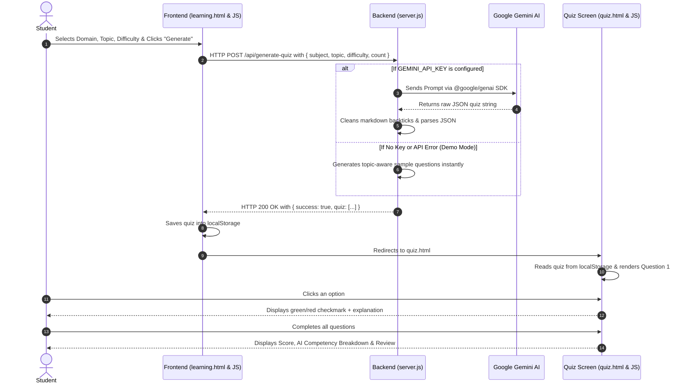

# 📘 Complete Guide: Understanding the SkillPilot AI Project
> **A Comprehensive, Plain-English Walkthrough for Beginners, First-Year Students, and Hackathon Teams.**

---

## 🌟 1. Project Overview in Simple Words

Imagine you are studying for an exam on **"Data Structures"** or **"Newton's Laws of Motion"**. 
Normally, textbooks only give you static questions. If you are a beginner, the questions might be too hard; if you are advanced, they might be too simple.

**SkillPilot AI** solves this problem by acting as a personal AI tutor:
1. You tell it: *"I want 5 intermediate questions on Binary Search Trees in Computer Science."*
2. You can even upload your class lecture notes or summary documents.
3. The application talks to **Google Gemini AI** behind the scenes.
4. Gemini crafts customized multiple-choice questions with 4 options and detailed explanations.
5. You take the quiz directly in your browser with **instant visual feedback**.
6. At the end, the AI analyzes your score and tells you:
   - What concepts you mastered (**Strengths**).
   - Where you struggled (**Competency Gaps**).
   - What you should study next (**Recommended Next Step**).

---

## 🧠 2. Core Concepts You Should Know

Before looking at the code, here are 6 essential web development concepts used in this project:

### 1. Frontend vs. Backend
- **Frontend (`index.html`, `learning.html`, `quiz.html`, CSS, JS)**:
  This is the visual part that runs inside the user's web browser (Google Chrome, Edge, etc.). It displays buttons, takes input, and listens for clicks.
- **Backend (`server.js`)**:
  This is the program running on the server (Node.js). It handles sensitive things like secret API keys, processes data, and talks to external services like Google Gemini.

### 2. What is an API?
**API** stands for *Application Programming Interface*. Think of a restaurant:
- **You (Frontend)** are the customer looking at a menu.
- **The Waiter (API / Route)** takes your order to the kitchen.
- **The Kitchen (Backend + Gemini AI)** prepares your food (quiz questions) and hands it back.

In this project, the frontend sends a `POST` request to `/api/generate-quiz`, and the backend returns the questions.

### 3. What is JSON?
**JSON** (*JavaScript Object Notation*) is the universal language computers use to exchange data. A quiz question looks like this in JSON:
```json
{
  "question": "What is the time complexity of searching a balanced Binary Search Tree?",
  "options": ["O(n)", "O(log n)", "O(n^2)", "O(1)"],
  "answer": 1,
  "explanation": "In a balanced BST, each comparison halves the search space, yielding O(log n) time."
}
```

### 4. What is an LLM & Prompt Engineering?
**Google Gemini** is a Large Language Model (LLM). In `server.js`, we give Gemini a precise set of instructions called a **Prompt**. We tell Gemini:
- The exact topic and difficulty.
- That it must return strictly valid JSON.
- That it must include 4 options, a 0-indexed correct answer, and an explanation.

### 5. Why do we use `localStorage`?
Browsers normally forget everything when you navigate from one webpage (`learning.html`) to another (`quiz.html`). 
`localStorage` is like a mini-notepad built into the browser:
- `learning.js` writes the generated quiz into `localStorage.setItem("generatedQuiz", ...)`.
- Then it redirects to `quiz.html`.
- When `quiz.html` opens, `quiz.js` reads `localStorage.getItem("generatedQuiz")` and immediately starts the quiz!

### 6. What is CORS?
**CORS** (*Cross-Origin Resource Sharing*) is a security rule in browsers. By adding `cors()` in Express (`server.js`), we ensure that web requests from our pages are permitted without security blocks.

---

## 🗺️ 3. Complete Step-by-Step Data Flow

Here is the exact journey of an event when a student uses SkillPilot:



---

## 📂 4. Deep Dive: Code Breakdown File by File

### 1. `server.js` (The Brain of the Application)
- **Lines 1–15 (Setup & Middleware)**:
  ```javascript
  import express from "express";
  import dotenv from "dotenv";
  import cors from "cors";
  import { GoogleGenAI } from "@google/genai";
  ```
  Initializes the Express server, loads secrets from `.env`, enables CORS, and serves frontend files using `express.static(".")`.

- **Lines 26–42 (Gemini Client Initialization)**:
  Checks if `process.env.GEMINI_API_KEY` exists. If present, it creates the `GoogleGenAI` instance. If not, it logs that the server will use Demo Mode.

- **Lines 44–140 (`generateFallbackQuiz`)**:
  A topic-aware fallback function. If someone runs the project offline or without an API key, this function builds realistic multiple-choice questions for the user's specific topic. This guarantees that your presentation will never crash.

- **Lines 142–270 (`handleGenerateQuiz`)**:
  - Validates that `subject` and `topic` were provided.
  - Constructs a prompt instructing Gemini to return JSON.
  - Calls `ai.models.generateContent({ model: "gemini-2.0-flash", ... })`.
  - Cleans any markdown tags (like ````json ... ````).
  - Converts the text to a JavaScript Array using `JSON.parse()`.
  - Normalizes every question so both `answer` and `correctAnswer` exist.
  - Returns `{ success: true, quiz: formattedQuiz }`.

- **Lines 280–295 (Server Listen)**:
  Starts the HTTP listener on port 3000 (`http://localhost:3000`).

---

### 2. `learning.html` & `learning.js` (The Workspace)
- **Difficulty & Question Count**:
  `learning.js` adds click listeners to `.difficulty` and `.question-btn` elements. When clicked, it removes the `.active` class from siblings and adds it to the clicked button, storing `selectedDifficulty` and `selectedQuestions`.
- **File Upload Support**:
  Clicking the "Browse Files" button triggers the hidden `<input type="file">`. Selecting files or dragging them into `#dropZone` adds them to an array and renders their names and file sizes in `#fileList`.
- **Generation Handler**:
  When `#generateBtn` is clicked:
  1. It validates input.
  2. It shows a spinning icon (`fa-spinner fa-spin`).
  3. It calls `fetch("/api/generate-quiz", ...)`.
  4. It stores the response in `localStorage`.
  5. It executes `window.location.href = "quiz.html"`.

---

### 3. `quiz.html` & `quiz.js` (The Interactive Quiz Engine)
- **Automatic Initialization**:
  On `DOMContentLoaded`, `quiz.js` checks `localStorage.getItem("generatedQuiz")`. If found, it immediately renders the questions and starts at Question 1.
- **Dynamic Question Rendering (`showQuestion`)**:
  - Updates `#currentQuestion` and `#totalQuestions`.
  - Computes progress percentage: `(currentQuestionIndex / total) * 100` and animates `#progressBar`.
  - Creates four `<button class="option">` elements.
- **Immediate Educational Feedback (`selectAnswer`)**:
  When an option is clicked:
  - If correct: Option turns green with a checkmark (`✓`).
  - If incorrect: Option turns red with a cross (`✗`) and highlights the correct option in green.
  - An `#inlineExplanation` box pops up showing Gemini's reasoning.
- **Results & Competency Analysis (`showResults`)**:
  - Tallies total correct answers.
  - Calculates percentage (`(score / total) * 100`).
  - Renders a score circle.
  - Dynamically builds an **AI Competency Analysis** (identifying Strengths if $\ge 80\%$, Progress if $\ge 50\%$, or Competency Gaps if $< 50\%$).
  - Renders a question-by-question review with the user's selection, correct answer, and explanation.

---

## 🎤 5. Viva / Interview Questions (Cheat Sheet)

If your teacher, professor, or hackathon judge asks you questions about this project, here are the exact answers to give:

### Q1: "What architecture pattern is used in this project?"
> **Answer**: *"We use a Client-Server architecture. The frontend is built with HTML5, Vanilla CSS, and JavaScript. The backend is built with Node.js and Express. The backend exposes RESTful API endpoints (`/api/generate-quiz`) that communicate with the Google Gemini 2.0 Flash model via the official `@google/genai` SDK."*

### Q2: "How do you pass data between `learning.html` and `quiz.html` without a database?"
> **Answer**: *"We use the browser's native `localStorage` API. When the server returns the generated questions, `learning.js` serializes the question array into JSON and saves it in `localStorage`. When `quiz.html` loads, `quiz.js` deserializes the data and initializes the quiz immediately."*

### Q3: "What happens if Gemini returns markdown formatting around the JSON?"
> **Answer**: *"LLMs sometimes wrap JSON in code fences like ````json ... ````. In `server.js`, we implemented regex sanitization to strip leading and trailing backticks before calling `JSON.parse()`. Furthermore, we specify `responseMimeType: 'application/json'` in the Gemini configuration."*

### Q4: "What happens if your internet drops or you hit the Gemini API quota during a live demo?"
> **Answer**: *"We built an automated fallback generator inside `server.js`. If the API key is missing or an API error occurs, the server automatically catches the exception and serves an intelligent, topic-aware demo quiz tailored to the chosen subject. The presentation will never fail."*

### Q5: "Why did you choose Gemini 2.0 Flash over other models?"
> **Answer**: *"Gemini 2.0 Flash offers exceptionally low latency (sub-second generation times) and strong structured JSON generation capabilities, making it ideal for interactive real-time educational quizzes."*

---

## 🚀 6. Future Roadmap (How to Expand This Project)

If you want to continue improving this project for a major project or final year submission:
1. **User Accounts & Authentication**: Add JWT authentication so students can sign up and track their progress over weeks.
2. **PDF Text Extraction**: Use `pdf-parse` or `multer` on the backend to extract text directly from uploaded lecture slide PDFs and feed excerpts into Gemini.
3. **Spaced Repetition Flashcards**: Automatically turn missed questions into review flashcards.
4. **Export to PDF**: Allow students to download a summary report card of their assessment.
